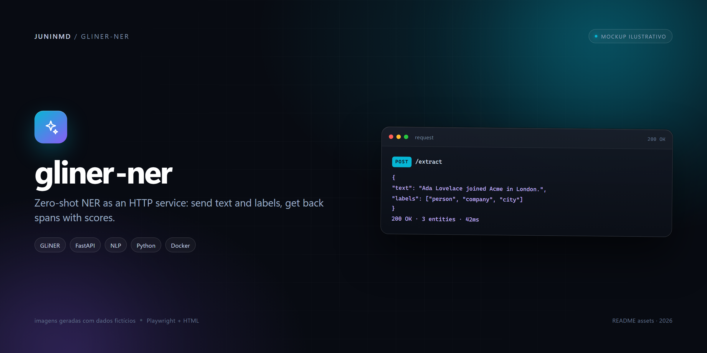
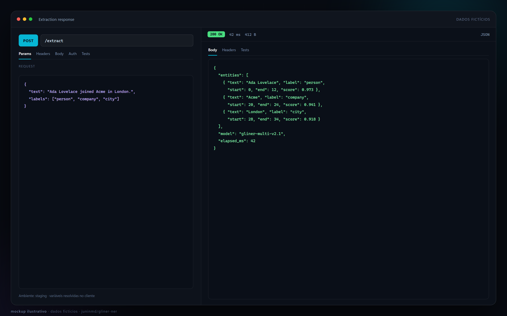

# gliner-ner

<p align="center">
  
</p>

**Zero-shot named-entity extraction as an HTTP service: send text and the labels you care about, get back spans with scores.**

Built on [GLiNER](https://github.com/urchade/GLiNER) and FastAPI. One process loads one model at startup and serves extraction over `/extract` and `/extract/batch`, so several applications in the cluster can share the same model instead of embedding it in each one.

## What it does

- Extracts entities for **arbitrary labels supplied per request** — no fine-tuning and no fixed entity schema.
- Falls back to a configurable default label set when a request omits labels.
- Returns character offsets (`start`, `end`), the matched text, the label and the model score for every entity.
- Accepts batches of up to `GLINER_MAX_BATCH_SIZE` texts (50 by default) and returns results keyed by caller-provided IDs.
- Enforces per-text length, batch size and threshold bounds with Pydantic validation.
- Exposes `/health` that reports whether the model is loaded.

## Requirements

- Python >= 3.12 (`requires-python` in `pyproject.toml`).
- [uv](https://docs.astral.sh/uv/) for the local workflow, or Docker.
- Network access on first start to download the model from Hugging Face, unless the model is already in the cache.
- CPU-only PyTorch by default: `pyproject.toml` maps `torch` to the `pytorch-cpu` index (`https://download.pytorch.org/whl/cpu`).

## Run locally

```bash
uv sync
PYTHONPATH=src uv run uvicorn gliner_ner.main:app --port 8080
```

On PowerShell, set the variable first:

```powershell
$env:PYTHONPATH = "src"
uv run uvicorn gliner_ner.main:app --port 8080
```

The first start downloads the model and can take a while. There are no latency numbers to promise here; it depends on the model, the machine and the text.

## Run with Docker

```bash
docker build -t gliner-ner .
docker run --rm -p 8080:8080 gliner-ner
```

The image is based on `python:3.12-slim`, installs dependencies with `uv sync --frozen --no-dev --no-editable`, and runs uvicorn on `0.0.0.0:8080`.

Inside the image, `HF_HOME` points to `/tmp/hf-cache`, which is **not** a volume: rebuilding or recreating the container downloads the model again. To persist the cache (example):

```bash
docker run --rm -p 8080:8080 -e HF_HOME=/cache -v gliner-hf:/cache gliner-ner
```

## API

| Method | Path | Purpose |
|---|---|---|
| `GET` | `/health` | Model status and configured model ID |
| `POST` | `/extract` | Extract entities from one text |
| `POST` | `/extract/batch` | Extract entities from up to `GLINER_MAX_BATCH_SIZE` texts |

FastAPI's default interactive docs are available at `/docs` and the schema at `/openapi.json`.

### `GET /health`

```json
{
  "status": "ok",
  "model": "urchade/gliner_multi-v2.1"
}
```

`status` is `"ok"` when the model object is loaded and `"loading"` otherwise. `model` is the configured model identifier (`GLINER_MODEL`), not the resolved revision on disk.

### `POST /extract`

Request body:

| Field | Type | Required | Rules |
|---|---|---|---|
| `text` | string | yes | 1 to `GLINER_MAX_TEXT_LENGTH` characters |
| `labels` | array of strings | no | At most `GLINER_MAX_LABELS` items of up to 100 characters each; blanks and repeats are dropped; omitted or empty (after cleaning) uses `GLINER_DEFAULT_LABELS` |
| `threshold` | number | no | 0 to 1; omitted uses `GLINER_DEFAULT_THRESHOLD` |

Response:

```json
{
  "entities": [
    {
      "text": "Lula",
      "label": "pessoa",
      "score": 0.98,
      "start": 0,
      "end": 4
    }
  ]
}
```

Example request:

```bash
curl -s localhost:8080/extract \
  -H 'content-type: application/json' \
  -d '{"text": "Lula esteve em Franca", "labels": ["pessoa", "local"]}'
```

> The JSON response above is the shape asserted in `tests/test_main.py`, where the model is mocked. Real scores and entities depend on the model and labels; treat `0.98` as a fixture value, not a benchmark.

`start` and `end` are character offsets into the submitted `text`, as returned by GLiNER.

### `POST /extract/batch`

Request body:

| Field | Type | Required | Rules |
|---|---|---|---|
| `items` | array of objects | yes | 1 to `GLINER_MAX_BATCH_SIZE` items |
| `items[].id` | string | yes | Key used in the response; must be unique within the request |
| `items[].text` | string | yes | 1 to `GLINER_MAX_TEXT_LENGTH` characters |
| `labels` | array of strings | no | Same rules as `/extract`; applies to every item |
| `threshold` | number | no | Applies to every item |

Response:

```json
{
  "results": {
    "a1": [
      {
        "text": "Lula",
        "label": "pessoa",
        "score": 0.98,
        "start": 0,
        "end": 4
      }
    ]
  }
}
```

Example request:

```bash
curl -s localhost:8080/extract/batch \
  -H 'content-type: application/json' \
  -d '{"items": [{"id": "a1", "text": "Lula esteve em Franca"}], "labels": ["pessoa", "local"]}'
```

`results` is a dictionary keyed by `items[].id`. Repeated IDs are rejected with `422` so no result is silently overwritten.

### Errors

| Status | When |
|---|---|
| `422` | Pydantic validation failed: empty text, text over the limit, more than `GLINER_MAX_BATCH_SIZE` items, repeated `items[].id`, missing `id`/`text`, too many or too long `labels`, or a `threshold` outside 0–1 |
| `503` | An extraction handler ran while the global model was `None`; body is `{"detail": "Model not loaded yet"}` |
| `500` | Anything raised inside GLiNER during prediction; FastAPI's default error response |

## Configuration

All variables are read **once, at module import time**. Changing them requires restarting the process.

| Variable | Default | Purpose |
|---|---|---|
| `GLINER_MODEL` | `urchade/gliner_multi-v2.1` | Hugging Face model ID passed to `GLiNER.from_pretrained` |
| `GLINER_DEFAULT_LABELS` | `pessoa,organização,local,empresa` | Comma-separated labels used when a request omits `labels`; empty entries are dropped |
| `GLINER_DEFAULT_THRESHOLD` | `0.5` | Score threshold used when a request omits `threshold` |
| `GLINER_MAX_TEXT_LENGTH` | `5000` | Maximum characters per text, also enforced by Pydantic |
| `GLINER_MAX_BATCH_SIZE` | `50` | Maximum number of items in `/extract/batch` |
| `GLINER_MAX_LABELS` | `50` | Maximum number of labels per request |

## Model lifecycle

- The model is loaded in the FastAPI lifespan handler with `GLiNER.from_pretrained(MODEL_NAME)`; it is released on shutdown.
- Startup is synchronous from the server's point of view: uvicorn does not accept requests until the lifespan startup finishes, so a running server normally answers `/health` with `"ok"` immediately. The `"loading"` status and the `503` branch are guards for requests that find the global model unset (for example, tests that clear it).
- Downloads go to the Hugging Face cache under `HF_HOME`. With the Docker image, that is `/tmp/hf-cache` unless you override it.
- Only one model per process. There is no per-request model selection, reload endpoint or warm-up endpoint.

## How it works

```text
src/gliner_ner/main.py     FastAPI app, Pydantic schemas, endpoints, lifespan
src/gliner_ner/__init__.py empty package marker
tests/test_main.py         pytest suite with a mocked model
Dockerfile                 python:3.12-slim + uv + uvicorn on 8080
pyproject.toml / uv.lock   dependencies, Python requirement, ruff config
```

Request flow:

```text
POST /extract
   │
   ├── Pydantic validates text / labels / threshold   (422 on failure)
   ├── _require_model()                               (503 if model is None)
   ├── model.predict_entities(text, labels, threshold)
   └── map each result to Entity(text, label, score, start, end)
```

`labels` is resolved with `labels or DEFAULT_LABELS`, so an empty array behaves like an omitted field. `threshold` is resolved with an explicit `is not None` check, so `0` is a valid threshold rather than falling back to the default.

Both endpoints are declared as regular `def` functions, so FastAPI runs them in its threadpool instead of blocking the event loop. The model instance itself is a single global object shared by those calls.

## Development and tests

```bash
uv sync
uv run ruff check .
PYTHONPATH=src uv run pytest
```

Ruff is configured with `line-length = 100`. The test suite uses `fastapi.testclient.TestClient` and monkeypatches `main.GLiNER.from_pretrained`, so it never downloads weights or touches the network. It covers `/health`, `/extract`, `/extract/batch`, the tested 422 cases (empty text, oversized batch) and the 503 path.

CI runs the same checks with locked dependencies:

```bash
uv sync --locked
uv run --frozen ruff check .
uv run --frozen pytest -q
```

## CI

| Workflow | Trigger | What it does |
|---|---|---|
| `build.yml` | pull request to `main`/`master` | `uv sync --locked`, `ruff check`, `pytest -q` |
| `validate.yml` | PR and push on `main` | Shared validation from `juninmd/base-actions` |
| `docker.yml` | push on `main`, manual | Reusable Docker build/push workflow with `packages: write` |
| `security.yml` | push on `main`, weekly cron | Shared security scan |

`build.yml` only runs on pull requests, not on pushes to `main`.

## Screenshots

> [!NOTE]
> **Illustrative mockups.** The screens below were rendered from HTML with fictitious data (Playwright). They are not captures of a real installation.

<p align="center">
  
  <br>
  <sub>Extraction response — fictitious data.</sub>
</p>


## Limitations

- **No authentication, TLS or rate limiting.** Anyone who can reach port 8080 can run extraction; put it behind the cluster's ingress/auth layer.
- **No GPU configuration.** The uv source pins CPU PyTorch; using CUDA means changing the dependency source and the image.
- **One model, fixed at startup.** Switching models requires a restart; there is no reload endpoint.
- **Environment is read at import.** `GLINER_*` changes need a process restart.
- **Free-form labels.** There is no label registry or normalization; spelling variants are different labels to the model.
- **Synchronous prediction.** Requests are handled in the threadpool, but there is no queue, batching across requests, timeout or cancellation.
- **No persistence.** Nothing is stored: no request log, no entity table, no cache of results.
- **Image availability is not documented.** The Docker workflow builds and pushes an image, but no pullable tag is referenced anywhere in the repository.
- **No test for model quality.** Tests mock the model; they verify the HTTP contract, not extraction accuracy.

## License

There is **no `LICENSE` file** in the repository, and `pyproject.toml` declares no license. Treat the code as all rights reserved until a license is added.
